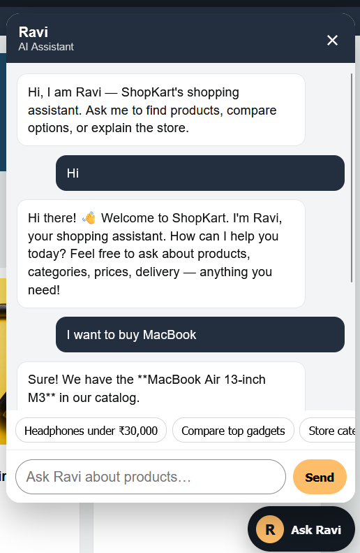
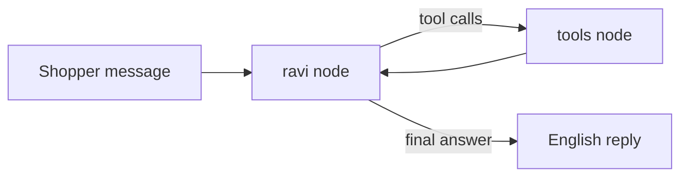
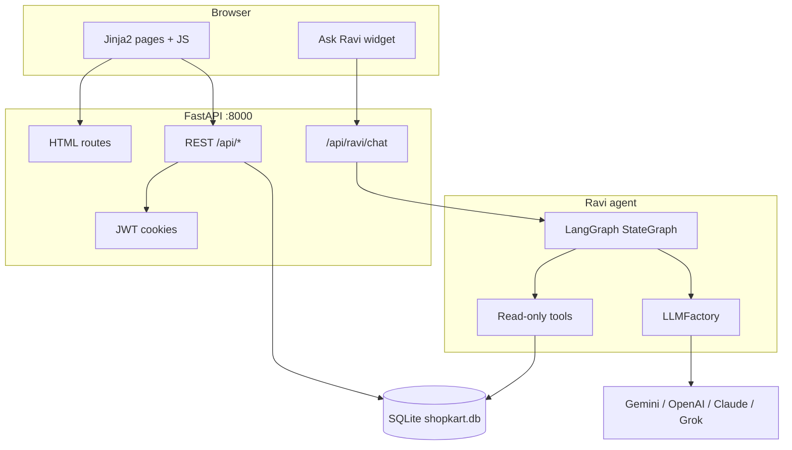

# ShopKart

**Amazon-style ecommerce** with a built-in **LLM shopping assistant** — backend and frontend served by one FastAPI process.

[](https://www.python.org/)
[](https://fastapi.tiangolo.com/)
[](https://langchain-ai.github.io/langgraph/)
[](https://python.langchain.com/)
[](https://www.sqlite.org/)
[](https://docs.astral.sh/uv/)

```bash
uv run python run.py
```

Open [http://127.0.0.1:8000](http://127.0.0.1:8000) → click **Ask Ravi** (bottom right).

<p align="center">
  
</p>

---

## Ravi — LLM shopping assistant

Ravi is ShopKart’s **Amazon Rufus–style** showroom guide. It helps shoppers search, compare, and understand products. It **cannot** change prices, stock, or catalog data.

| What shoppers can ask | What Ravi will not do |
| --- | --- |
| Find headphones under ₹30,000 | Add / edit / delete products |
| Compare two gadgets | Change ratings or reviews |
| Explain categories, delivery, returns | Place orders or edit the cart |
| Open a product page (`/product/12`) | Access other customers’ data |

Replies are **English only**. The widget keeps the last 8 turns of chat history and sends them with each request.

### Why it is agentic

Ravi is not a single `llm.invoke(prompt)` call. It is a **LangGraph ReAct loop**:



1. **`ravi` node** — `LLMFactory.create()` builds the configured chat model, binds read-only tools, and prepends the system prompt plus a **live catalog snapshot** from SQLite.
2. **`tools_condition`** — if the model emits tool calls, LangGraph routes to the tool node; otherwise the graph ends.
3. **`tools` node** — `ToolNode` runs SQLAlchemy queries (read-only) and returns JSON to the model.
4. The model writes a short answer with name, ₹ price, and `/product/{id}` links.

Most simple questions are answered from the snapshot in **one** Gemini/OpenAI call. Tools run only when the model needs filtered search, reviews, or a side-by-side compare.

### LLM factory (swap any provider)

All providers implement `BaseLLMProvider.build()` and return a LangChain `BaseChatModel`. `LLMFactory.create()` picks the class from `LLM_PROVIDER`.

| `LLM_PROVIDER` | Class | SDK | Env key | Default model |
| --- | --- | --- | --- | --- |
| `gemini` | `GeminiLLM` | `ChatGoogleGenerativeAI` | `GOOGLE_API_KEY` | `gemini-2.0-flash` |
| `openai` | `OpenAILLM` | `ChatOpenAI` | `OPENAI_API_KEY` | `gpt-4o-mini` |
| `anthropic` | `AnthropicLLM` | `ChatAnthropic` | `ANTHROPIC_API_KEY` | `claude-sonnet-4-0` |
| `grok` | `GrokLLM` | `ChatOpenAI` + xAI base URL | `GROK_API_KEY` | `grok-3-mini` |
| `openrouter` | `OpenRouterLLM` | `ChatOpenAI` + OpenRouter | `OPENROUTER_API_KEY` | `openrouter/free` |

`.env` is **re-read on each LLM build** (`get_settings()`), so changing the provider or model does not require editing Python.

Gemini uses `google_api_key` and `max_retries=1` to avoid retry storms on free-tier `429` limits.

### Read-only tools

Defined in `app/ai/tools.py`. None of these `commit()` writes.

| Tool | Role |
| --- | --- |
| `search_products` | Name / brand / description search, category slug, price range, sort |
| `get_product_details` | One product by numeric id |
| `list_categories` | Category names, slugs, product counts |
| `get_product_reviews` | Existing reviews only (does not post a review) |
| `compare_products` | Two product ids side by side |
| `get_store_info` | Static store facts: about, shopping, delivery, returns, accounts |

### Chat API

| Method | Path | Notes |
| --- | --- | --- |
| `GET` | `/api/ravi/status` | Provider, model, whether an API key is set |
| `POST` | `/api/ravi/chat` | `{ "message": "...", "history": [{ "role", "content" }] }` → `{ "reply", "assistant": "Ravi" }` |

No login is required to talk to Ravi. It never loads another user’s cart or orders.

**Configure Ravi** (copy `.env.example` → `.env`):

```env
LLM_PROVIDER=gemini
LLM_TEMPERATURE=0.3
GOOGLE_API_KEY=your-key
GEMINI_MODEL=gemini-2.0-flash
```

Free-tier Gemini quotas are **per model**. `gemini-2.5-flash-lite` is often 20 requests/day; prefer `gemini-2.0-flash` or another provider if you hit `429`.

---

## Store features

- Catalog, search, category filter, sort (featured / price / rating)
- Product detail, reviews, cart, wishlist, checkout, orders
- Profile and saved addresses
- Admin console: create / edit / delete products, update order status
- Auth: email/password + **JWT access (15 min) + refresh (7 days, rotate + revoke)**
- Optional **Google / GitHub OAuth** (Authlib). Buttons hide if client ids are empty.

### Demo accounts

| Role | Email | Password |
| --- | --- | --- |
| Customer | `demo@shopkart.com` | `demo123` |
| Admin | `admin@shopkart.com` | `admin123` |

Admin → [http://127.0.0.1:8000/admin](http://127.0.0.1:8000/admin)

Seeded star ratings on product cards are **demo numbers** in `products.rating`. Real review rows are created only when a logged-in user submits a review.

---

## Architecture



One process (`uv run python run.py`) serves:

- Jinja2 templates + `/static`
- REST APIs
- Ravi agent

---

## Quick start

Requires [uv](https://docs.astral.sh/uv/) and **Python 3.10.5** (pinned in `.python-version`).

```bash
uv python install 3.10.5
uv sync
copy .env.example .env
# set GOOGLE_API_KEY (or another provider key)
uv run python run.py
```

On first boot, SQLAlchemy creates tables and `app/seed.py` loads sample products and demo users into `shopkart.db`.

---

## Tech stack

| Layer | Choice |
| --- | --- |
| Runtime | Python **3.10.5** |
| Packages | **uv** (`pyproject.toml` + lockfile) |
| HTTP | FastAPI + Uvicorn |
| UI | Jinja2, vanilla JS, CSS (Amazon-inspired navy / orange) |
| ORM / DB | SQLAlchemy 2 + **SQLite** |
| Auth | PyJWT (HS256), PBKDF2 passwords, Authlib OAuth |
| Agent | LangChain tools + **LangGraph** `StateGraph` / `ToolNode` |
| LLMs | `langchain-google-genai`, `langchain-openai`, `langchain-anthropic` |

---

## Project layout

```text
app/
  main.py              # FastAPI app, routers, static mount
  config.py            # Pydantic settings + get_settings()
  models.py            # Users, products, cart, orders, reviews, refresh tokens
  routers/             # auth, catalog, cart, orders, admin, ravi, pages
  ai/
    graph.py           # LangGraph ReAct workflow
    service.py         # ask_ravi()
    tools.py           # Read-only catalog tools
    catalog.py         # Snapshot injected into the system prompt
    prompts.py         # Ravi system prompt + store facts
    llm/
      factory.py       # LLMFactory
      gemini.py        # ChatGoogleGenerativeAI
      openai.py
      anthropic.py
      grok.py          # OpenAI-compatible xAI endpoint
run.py                 # uvicorn entrypoint
```

---

## Auth (JWT + OAuth)

| Token | Lifetime | Storage |
| --- | --- | --- |
| Access | 15 minutes | HttpOnly cookie + JSON body |
| Refresh | 7 days | HttpOnly cookie + JSON body; SHA-256 hash in `refresh_tokens` |

Refresh **rotates**: the old row is revoked and a new pair is issued. `POST /api/auth/logout` revokes the refresh token.

OAuth callbacks (optional):

- `http://127.0.0.1:8000/api/auth/oauth/google/callback`
- `http://127.0.0.1:8000/api/auth/oauth/github/callback`

---

## Environment

See `.env.example`. Important LLM variables:

| Variable | Purpose |
| --- | --- |
| `LLM_PROVIDER` | `gemini` \| `openai` \| `anthropic` \| `grok` \| `openrouter` |
| `LLM_TEMPERATURE` | Default `0.3` |
| `LLM_CALL_GAP_SECONDS` | Pause between LLM calls (default `6`). Helps Gemini free-tier RPM. Set `0` to disable. |
| `GOOGLE_API_KEY` / `GEMINI_MODEL` | Gemini |
| `OPENAI_API_KEY` / `OPENAI_MODEL` | OpenAI |
| `ANTHROPIC_API_KEY` / `ANTHROPIC_MODEL` | Claude |
| `GROK_API_KEY` / `GROK_MODEL` / `GROK_BASE_URL` | xAI (`https://api.x.ai/v1`) |
| `OPENROUTER_API_KEY` / `OPENROUTER_MODEL` / `OPENROUTER_BASE_URL` | OpenRouter (`https://openrouter.ai/api/v1`) |

Never commit `.env`. `shopkart.db` and `.venv` are gitignored.

---

## Testing Ravi (DeepEval)

End-to-end tests run the real LangGraph agent, then score the turn with DeepEval (**Answer Relevancy**, **Faithfulness** against the live catalog snapshot, and **Tool Correctness** when expected).

```bash
uv sync --group dev
uv run pytest tests/test_ravi_agent_e2e.py -v
```

Needs `LLM_PROVIDER` plus that provider’s API key. The judge prefers `OPENROUTER_API_KEY`, then `OPENAI_API_KEY`, then `GOOGLE_API_KEY`. Tests set `LLM_CALL_GAP_SECONDS=0` so they do not sleep between calls.

---
